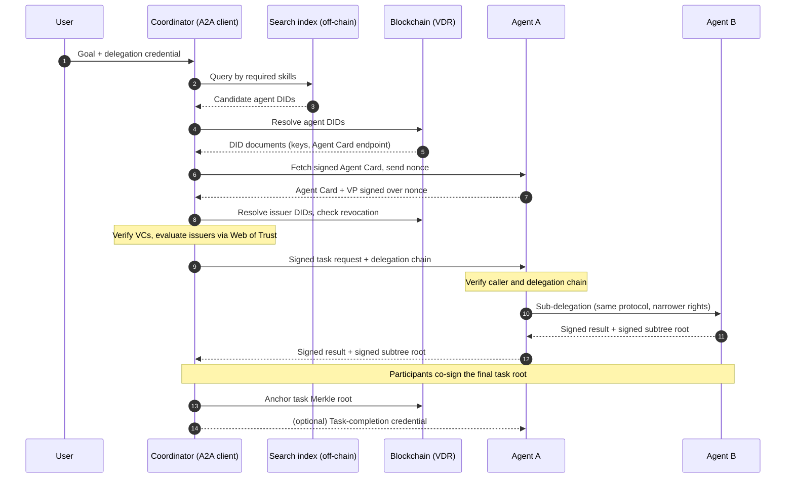

# Trust-Aware Agentic AI: Integrating A2A with Self-Sovereign Identity and Web of Trust

## At a glance

- Every agent and every issuer has a DID registered on a blockchain, which acts as the Verifiable Data Registry (VDR).
- Agents are discovered by skill through an off-chain search index. The index is untrusted, so every result is re-verified on-chain.
- Agents prove claims about themselves (affiliation, certifications, authorizations) with Verifiable Credentials. They present them as a Verifiable Presentation signed over a nonce chosen by the client.
- A cryptographically valid credential is not enough. Each verifier decides whether to trust the issuer through a Web of Trust built from its own trust anchors and issuer endorsements. This is the core research contribution.
- Verification goes both ways. The caller verifies the callee's capabilities, and the callee verifies the caller's delegation chain back to the user.
- Every exchange is signed and acknowledged. Logs stay off-chain with each agent. Only a co-signed Merkle root per task is anchored on-chain.

---

## 1. Goal

In an open ecosystem, agents from different organizations must discover each other, delegate tasks and collaborate without knowing each other in advance. A2A standardizes how agents communicate, but an Agent Card is a self-declaration: it does not prove that the agent's claims are true. This architecture adds a trust layer based on SSI (DIDs and VCs) and a decentralized trust model (Web of Trust), with no shared central trust authority. It also adds tamper-evident auditing of multi-agent tasks.

## 2. Building blocks

| Component | Role in the architecture |
|---|---|
| **A2A protocol** | Agent-to-agent communication and task lifecycle. Agents describe themselves with an Agent Card, which A2A 1.0 allows to be signed with JWS. |
| **DID / DID document** | Decentralized identifier of each agent and issuer. It resolves to the public keys and a service endpoint pointing to the Agent Card. |
| **Verifiable Credential (VC)** | Signed claim by an issuer about an agent, e.g. "belongs to org X", "certified for Y", "authorized to do Z". |
| **Verifiable Presentation (VP)** | Package of VCs presented by the agent and signed with its own key, which proves possession. |
| **Blockchain (VDR)** | Public, tamper-evident registry of DIDs, issuer keys and revocation status. It also stores anchored audit roots. |
| **Web of Trust (WoT)** | Per-verifier model that decides whether to trust an issuer it does not directly know, using endorsements and trust propagation. |
| **Merkle anchoring** | Off-chain signed logs, with only the Merkle root written on-chain per task. |

## 3. Roles

| Role | Who | Responsibilities |
|---|---|---|
| **User** | Human or organization | States the goal and issues the root delegation credential to the coordinator |
| **Coordinator** | A2A client agent | Discovers agents, verifies them, evaluates trust, delegates, composes the final audit root and anchors it |
| **Agent** | A2A server agent | Owns its DID and holds its VCs. Signs its Agent Card and messages, presents VPs, keeps its own log segment. It becomes a client itself when it sub-delegates. |
| **Issuer** | Agent operator, organization, certification body, auditor | Issues VCs about agents and may endorse other issuers |
| **Trust anchors** | Issuers that a given verifier trusts directly | Starting points for Web of Trust evaluation, set by local policy |
| **Search index** | Off-chain service, rebuildable from the chain | Capability search over registered agents |

Every agent plays several SSI roles: holder of its own credentials, verifier of the agents it calls, and potentially issuer of task-completion attestations.

## 4. What lives where

| Data | Location | Rationale |
|---|---|---|
| Agent DIDs and DID documents (keys, Agent Card endpoint) | On-chain | Public, tamper-evident resolution. The full history supports key rotation. |
| Issuer DIDs | On-chain | Verifiers must resolve issuer keys to check VC signatures |
| Revocation / status lists | On-chain | Status can be checked without contacting the issuer |
| Issuer endorsements (WoT edges) | Exchanged as VCs | Input to trust evaluation |
| Agent Cards | Off-chain at the agent's endpoint, signed with the agent's DID key | Large and frequently updated |
| VCs | Off-chain, held by the agent | No need to publish them |
| Skill search index | Off-chain, untrusted | Blockchains are poor at queries |
| Task logs | Off-chain, each agent stores its own segment | Cost, latency, privacy, GDPR |
| Task Merkle roots | On-chain | Trusted timestamp, ordering, tamper evidence |

Agent DIDs are public by design. Human holders should avoid public DIDs because they make users correlatable across verifiers. Agents, like issuers, *want* to be discoverable, so this privacy concern does not apply to them.

## 5. End-to-end flow



### Step 1: Registration

- Every agent and every issuer registers its own DID on-chain. Only the DID controller can create or update a DID document.
- The DID document lists the public keys and a service endpoint pointing to the Agent Card.
- Issuers publish revocation status lists on the registry, or commitments to them.

### Step 2: Discovery

- The coordinator derives the required skills from the user's goal.
- It queries an off-chain search index built from the on-chain registry and the Agent Cards it references.
- The index is untrusted. It can hide agents but cannot forge them, because the client re-verifies every result against the chain: resolve the DID, fetch the Agent Card, verify the card's signature with the DID key.
- Capability matching (semantic, possibly LLM-based) happens off-chain.
- Discovery is not trust. The registry says that an agent exists and which keys it controls. It does not say whether the agent should be trusted.

### Step 3: Authentication

- The client fetches the signed Agent Card and sends a fresh nonce.
- The agent replies with a VP that contains its VCs and is signed over the nonce with its DID key.
- This prevents replay. VCs are not secret, and an impostor serving copied VCs from its own endpoint cannot sign the nonce.
- The binding persists for the whole session. Every later message signature is verified against the same DID that the VCs were issued to.

### Step 4: Credential verification and trust evaluation

**Cryptographic verification**

- issuer signature on each VC, with the issuer DID resolved on-chain
- validity period
- revocation status
- credential subject equal to the agent's DID
- claims that actually cover the required skill or authorization

**Trust evaluation**

- Each verifier has its own trust anchors, the issuers it trusts directly.
- Unknown issuers are evaluated through endorsements, which are credentials in which one issuer vouches for another.
- Policy parameters: maximum path length, trust decay per hop, aggregation over multiple paths, and thresholds that depend on the risk of the requested action.
- A cryptographically valid VC from an untrusted issuer is rejected.

### Step 5: Authorization of the caller

- The called agent verifies who the caller is and on whose behalf it acts. This addresses the risk of agents operating with delegated human or service credentials.
- Delegation is a chain of credentials: User → Coordinator → Agent A → Agent B.
- Each link is signed by the delegator and names the delegatee's DID. A link can only narrow rights (allowed actions, resources, expiry, budget), never widen them. This is attenuation, as in UCAN-style capability chains.
- The callee verifies the entire chain back to the user before executing.

### Step 6: Recursive delegation

- Every agent that sub-delegates becomes a client and repeats Steps 2–5 for its own sub-agents.
- Verification results can be cached per session so they are not repeated for every request.

### Step 7: Signed exchanges and audit anchoring

- Every request is signed by its sender and every response by its responder. The counterparty returns a signed receipt, so no party can later omit a step.
- Each agent keeps its own log segment locally.
- Together with its response, an agent returns the signed root of its subtree, which covers its own exchanges and the roots of its sub-delegations.
- The coordinator composes the final task root. All participants co-sign it, and only that root is anchored on-chain.
- Anchoring is triggered by any terminal state (completed, failed, canceled, rejected). Long-running tasks, e.g. those waiting for human input, also get timeout-based checkpoints.

### Step 8: Feedback into the Web of Trust

- After anchoring, the coordinator may issue a task-completion credential to the agent, such as "agent X completed task Y correctly". It references the anchoring transaction.
- The agent can present this credential in future interactions, and verifiers can use it as evidence in trust evaluation.

## 6. Audit log structure

**Leaf (one per logged event)**

```json
{
  "taskId": "...",
  "step": "request | response | receipt | status-change",
  "from": "did:example:coordinator",
  "to": "did:example:agentA",
  "payloadHash": "sha256(salt || payload)",
  "authorization": "hash of the delegation credential used",
  "timestamp": "...",
  "signature": "..."
}
```

**Nested trees that mirror the delegation chain**

```
Task root  (co-signed, anchored on-chain)
├── request   Coordinator → A      (signed by Coordinator)
├── response  A → Coordinator      (signed by A)
├── receipt   Coordinator → A      (signed by Coordinator)
└── subtree root of A → B          (signed by A and B)
    ├── request   A → B            (signed by A)
    ├── response  B → A            (signed by B)
    └── subtree root of B → C ...
```

**Properties**

- **Selective disclosure:** a single step can be revealed to an auditor with its inclusion proof, without revealing the rest of the task.
- **Privacy across hops:** A sees only the root of B's subtree, not the details of B's sub-delegations.
- **Salted payload hashes:** they prevent guessing low-entropy payloads from their hashes. Payloads themselves never leave the agents' local storage.
- **Accountability for permissions:** the `authorization` field records which delegation credential authorized each action.
- **Batching:** per-task roots can be aggregated into a periodic batch root, so only one transaction is needed per batch. Each task keeps an inclusion proof to the batch root.

## 7. Key design decisions

- **The blockchain is a registry, not a trust authority.** It provides tamper-evident resolution of identifiers, keys and status without a single operator. Whether to trust an issuer is decided by each verifier through the Web of Trust.
- **Message-level signatures are required.** A signed Agent Card proves the card's integrity and who signed it, but it does not cover later task requests.
- **Only Merkle roots go on-chain.** Full logs on-chain would be costly and slow, would expose task content, and their immutability conflicts with the GDPR right to erasure.
- **What the chain adds beyond signatures.** Signatures already give non-repudiation. The chain adds trusted timestamps and ordering, and it prevents a log custodian from rewriting or deleting history, without a shared trusted third party. Within a single organization, a transparency log (e.g. Certificate Transparency, Sigstore Rekor) would be a sufficient baseline for comparison.
- **Receipts cover the pre-anchoring window.** Tampering with an in-progress log is detectable because the counterparty holds signed copies. Anchoring mainly protects against collusion and log loss.
- **`did:web` vs a ledger-based DID method.** `did:web` needs no blockchain but inherits trust from DNS and TLS certificate authorities, which are the central points this design aims to avoid.
- **Key rotation.** The chain preserves the full DID document history, so logs signed with old keys remain verifiable.

## 8. Threats and mitigations

| Threat | Mitigation |
|---|---|
| Forged or tampered Agent Card | Card signed with the agent's DID key (JWS), key resolved on-chain |
| Impostor replaying copied VCs | VP signed over a client-chosen nonce (proof of possession) |
| Valid VC from a rogue or unknown issuer | Web of Trust evaluation starting from the verifier's trust anchors |
| Revoked or expired credential | Status list check on the registry, validity period check |
| Malicious or censoring search index | Index treated as untrusted, every result re-verified on-chain, multiple indexes |
| Privilege escalation along the delegation chain | Attenuated delegation credentials, full-chain verification by the callee |
| Log tampering or omission | Signed messages, counterparty receipts, co-signed anchored Merkle root |
| Agent key compromise | Key rotation via DID document update, with history preserved on-chain |

## References

- A2A Protocol specification: https://a2a-protocol.org/latest/specification/
- W3C Decentralized Identifiers (DIDs): https://www.w3.org/TR/did-core/
- W3C Verifiable Credentials Data Model 2.0: https://www.w3.org/TR/vc-data-model-2.0/