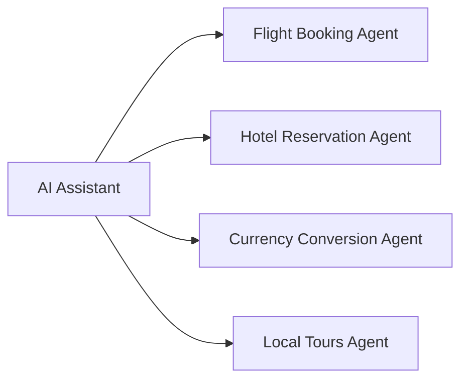

# A2A Network Example

## Scenario

An AI Assistant receives a travel planning request from the user (e.g. *"Plan a 3-day trip to Milan next week, including flights, hotel and some local tours, with a budget in USD"*). It discovers the available specialized agents by reading their Agent Cards, selects the ones whose skills match the request, and delegates sub-tasks to them.

## Agents

| Agent | Port | Advertised skill | Behaviour |
|---|---|---|---|
| Flight Booking Agent | 9001 | `flight-booking` | Returns plausible mock flight options |
| Hotel Reservation Agent | 9002 | `hotel-reservation` | Returns plausible mock hotel options |
| Currency Conversion Agent | 9003 | `currency-conversion` | Converts amounts using mock exchange rates |
| Local Tours Agent | 9004 | `local-tours` | Suggests mock tours and activities at the destination |
| AI Assistant | — | — | Discovers agents, selects them and delegates tasks |