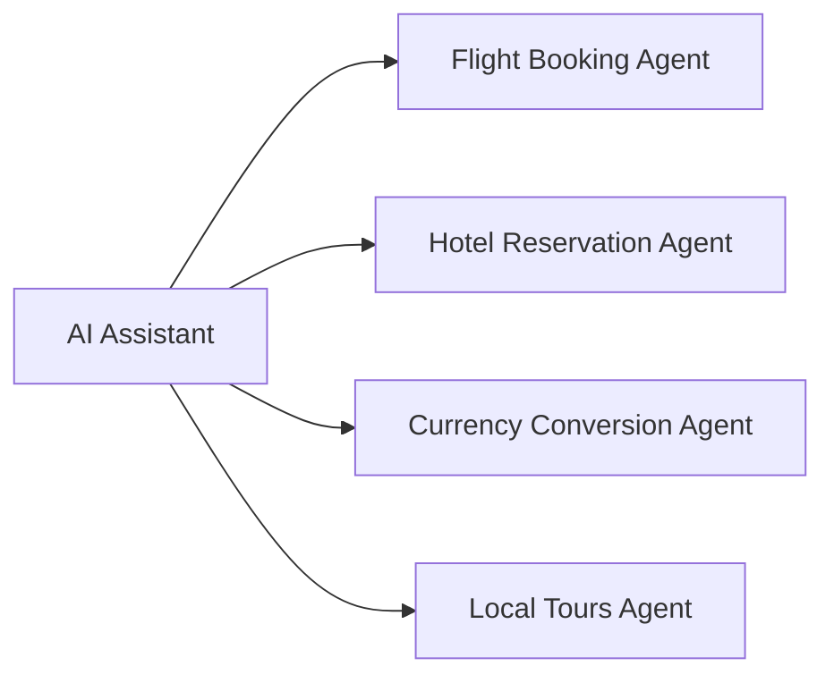

# A2A Network Example

## Scenario

An AI Assistant receives a travel planning request from the user (e.g. *"Plan a 3-day trip to Milan next week, including flights, hotel and some local tours, with a budget in USD"*). It discovers the available specialized agents by reading their Agent Cards, selects the ones whose skills match the request, and delegates sub-tasks to them.



## Agents

| Agent | Port | Advertised skill | Behaviour |
|---|---|---|---|
| Flight Booking Agent | 9001 | `flight-booking` | Returns plausible mock flight options |
| Hotel Reservation Agent | 9002 | `hotel-reservation` | Returns plausible mock hotel options |
| Currency Conversion Agent | 9003 | `currency-conversion` | Converts amounts using mock exchange rates |
| Local Tours Agent | 9004 | `local-tours` | Suggests mock tours and activities at the destination |
| AI Assistant | — | — | Discovers agents, selects them and delegates tasks |

## Running the example

With the project installed with the `examples` extra (`pip install -e ".[examples]"` from the repository root), start each agent in its own terminal, from `examples/a2a_network`:

```bash
python -m agents.flight_booking
python -m agents.hotel_reservation
python -m agents.currency_conversion
python -m agents.local_tours
```

Then run the assistant, optionally with your own request (the default is the one of the scenario):

```bash
python -m assistant "Plan a 3-day trip to Milan next week, including flights, hotel and some local tours, with a budget in USD"
```

## How the assistant works

1. **Discovery** (`assistant/discovery.py`): reads the Agent Card of each known agent from `<url>/.well-known/agent-card.json`, skipping the agents that are not running.
2. **Selection** (`assistant/selection.py`): selects the skills that have a tag among the words of the request (e.g. `flights`, `hotel`, `tours`, `usd`).
3. **Delegation** (`assistant/delegation.py`): forwards the request to the selected agents, in parallel. The Currency Conversion Agent is not asked about the trip: it is used to convert the budget.
4. **Budget** (`assistant/budget.py`): takes the cheapest offer of each agent and, when the request names a currency (e.g. `in USD`), asks the Currency Conversion Agent to convert the costs priced in other currencies.

## Messages

Every agent replies with one A2A message made of two parts:

- a text part, for people;
- a data part, for the assistant: `{"offers": [{"name": ..., "price": ..., "currency": ...}]}` from the travel agents, `{"amount": ..., "currency": ...}` from the Currency Conversion Agent.

Flights are priced in USD, hotels and tours in the local currency of the city (e.g. EUR in Milan).