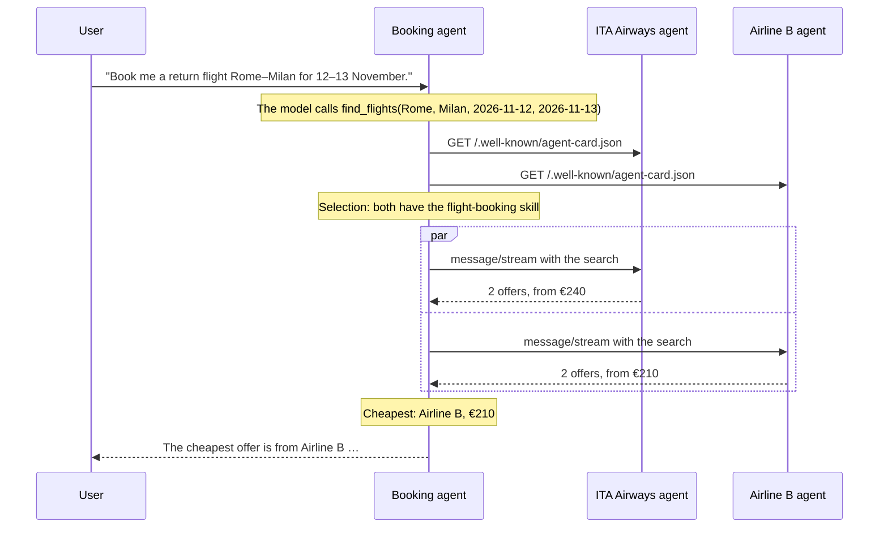

# ADK and A2A example

Agents built with Google's [Agent Development Kit](https://github.com/google/adk-js) (ADK) for TypeScript, talking to each other over the A2A protocol. The Booking agent, driven by an LLM, finds the cheapest return flight for a user:

1. it discovers the airline agents by reading their Agent Cards;
2. it selects those with the `flight-booking` skill;
3. it delegates the search to them over A2A;
4. it picks the cheapest offer.

The agents and the request come from the business trip scenario of [examples/end_to_end](../end_to_end/README.md).

## Agents

| Agent | Role | Port | Skill | Model |
|---|---|---|---|---|
| Booking agent | A2A client: interprets the request, discovers the airlines, delegates, picks the cheapest offer | — | — | Gemini, or a rule-based model |
| ITA Airways agent | A2A server | 9001 | `flight-booking` | none |
| Airline B agent | A2A server | 9002 | `flight-booking` | none |

The airlines are ADK agents without an LLM: they answer with mock offers from a deterministic tool. Each agent runs in its own process. They communicate only over A2A, with JSON-RPC over HTTP on localhost.

## How to run

Requirements: Node.js 26 (see [`.nvmrc`](../../.nvmrc) at the repository root; any Node ≥ 22.12 should work). This example is a self-contained npm project: the library at the repository root does not need to be installed.

```bash
cd examples/adk_a2a
npm install
cp .env.example .env               # then put your Gemini API key in .env
npm run demo                       # the demo, with Gemini
npm test                           # the tests: no LLM, no API key
```

| Variable | Used by | Default |
|---|---|---|
| `GOOGLE_API_KEY` | `npm run demo`. If it is missing, the demo stops with a message saying how to set it | — |
| `GEMINI_MODEL` | `npm run demo` | `gemini-3.8-flash` |

The demo reads them from `.env` ([`.env.example`](.env.example) is the template). Variables already set in the environment take precedence. `.env` is ignored by git.

Other ways to run the demo:

```bash
npm run demo -- --deterministic                                       # rule-based model: no LLM, no key
npm run demo -- "One-way flight from Naples to Turin on 20 November"  # another request
```

The demo and the tests start the airline agents and stop them at the end, so no other terminal is needed. The demo uses ports 9001 and 9002. The tests use 9101–9102 and 9111–9112, so they can run while a demo is running. An airline can also be started on its own with `npx tsx src/start_airline.ts ita` (or `airline-b`), optionally followed by `--port <port>`.

Nothing leaves localhost, except the Gemini API calls of `npm run demo`.

## How it works



### Code layout

```
examples/adk_a2a
  package.json          pinned: @google/adk 2.5.0, @a2a-js/sdk 0.3.14 (the version ADK 2.5.0
                        depends on, so there is one copy), express 5.3.0, zod 4.6.7
  src/
    flights.ts          mock flight search, deterministic
    airline.ts          airline agent (BaseAgent + FunctionTool), its Agent Card, its A2A server
    start_airline.ts    entry point of an airline process
    discovery.ts        Agent Cards, selection by skill
    delegation.ts       RemoteA2AAgent, cheapest offer
    booking.ts          Booking LlmAgent and its find_flights tool
    models.ts           Gemini from the environment, rule-based model
    launcher.ts         starts and stops the airline processes
    demo.ts             the demo
  tests/
    airlines.test.ts    Agent Cards, selection, delegation over A2A
    booking.test.ts     cheapest offer, rule-based model, missing API key
```

### The airline agents

`AirlineAgent` extends ADK's `BaseAgent`. Its `runAsyncImpl` parses the flight search, sent as JSON in the request's text, and calls its `search_flights` tool directly. The tool is a regular ADK `FunctionTool`, whose zod schema validates the search. The agent replies with one event, whose text is the JSON result, and ADK turns it into an A2A artifact. If the search is invalid, the tool throws, and Booking receives the A2A task as `failed`, with the tool's error.

Fares grow with the distance between the airports. Every search is deterministic, and each airline prices routes differently. For Rome–Milan, 12–13 November:

| Airline | Flights | Price |
|---|---|---|
| ITA Airways | AZ2010 07:00, AZ2035 19:00 | €240 |
| ITA Airways | AZ2022 13:00, AZ2061 21:00 | €265 |
| Airline B | XB301 06:30, XB318 20:30 | €210 |
| Airline B | XB305 10:15, XB322 22:45 | €255 |

ADK's `toA2a()` serves each airline. It returns an Express application with the Agent Card at `/.well-known/agent-card.json` and the A2A endpoint at `/jsonrpc` ([`src/airline.ts`](src/airline.ts)):

```ts
const card = await airlineAgentCard(profile, agent, url)
const app = await toA2a(agent, { host: 'localhost', port, agentCard: card, allowUnauthenticated: true })
app.listen(port, 'localhost')
```

ADK can generate the Agent Card from the agent (`getA2AAgentCard`), but its only skill is named after the agent. The airline starts from that card and replaces the skill with `flight-booking`, the one Booking looks for. `toA2a()` refuses to start without authentication unless `allowUnauthenticated: true` is set. With it set, ADK prints a security warning at startup, which shows in the demo output. That is acceptable here, because the servers listen on localhost only.

### The Booking agent

Booking is an ADK `LlmAgent` with one tool, `find_flights`. The model only interprets the request and words the answer. The tool does the rest, deterministically:

1. **Discovery.** It reads the Agent Cards at the known URLs (`http://localhost:9001` and `:9002`) with the A2A SDK's `DefaultAgentCardResolver`, skipping the agents that do not answer.
2. **Selection.** It keeps the agents whose card lists the `flight-booking` skill, as in [examples/a2a_network](../a2a_network/assistant/selection.py), except that the match is on the skill id instead of the tags.
3. **Delegation.** It asks the selected airlines in parallel. Each request goes through ADK's `RemoteA2AAgent`. The agent is created from the card already fetched and runs in its own `InMemoryRunner` session, so the search is the only message forwarded. `RemoteA2AAgent` uses streaming (`message/stream`), because the cards declare it.
4. **Cheapest offer.** It returns all offers and the cheapest one to the model.

The search and the offers travel as JSON in text parts. ADK turns an incoming A2A data part into text for the agent. On the way out, it produces data parts only for function calls and responses and for code execution.

The instruction tells the model that today is 2 November 2026, the day of the request in the scenario, so "12–13 November" means 2026.

In the tests and with `--deterministic`, the model is `RuleBasedModel`, a `BaseLlm` subclass. It reads the cities and dates with regular expressions, emits the `find_flights` call, and words the answer from the tool's result. The agent, the tool and the A2A traffic are those of the Gemini run.

With Gemini, ADK retries 408, 429 and 5xx answers up to 3 times, at most 30 s per attempt. The options are set in the agent's `generateContentConfig.httpOptions`, which ADK passes to `@google/genai`. The default model is `gemini-3.8-flash`, not ADK 2.5.0's default `gemini-2.5-flash`, which the Gemini API refuses to new users as of November 2026.
