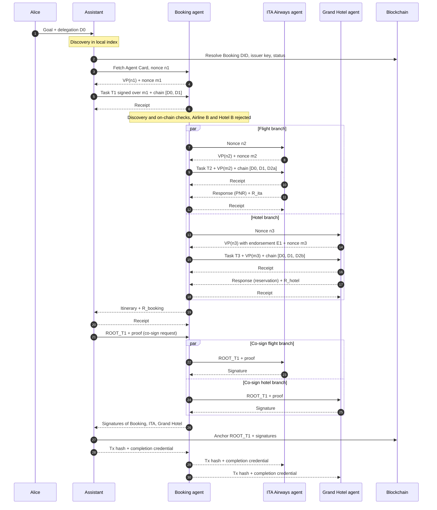

# End-to-End Example: Booking a Business Trip

## 1. Scenario

Alice, a consultant based in Rome, has a client meeting in Milan on Thursday 12 November 2026. On Monday 2 November she asks her personal assistant agent:

> "Book me a return flight Rome–Milan for 12–13 November and one night in a hotel near the city centre. Total budget €500."

The Assistant knows no travel provider in advance. It discovers a travel booking agent (Booking). Booking in turn discovers an airline agent (ITA Airways) and a hotel agent (Grand Hotel) and delegates to both in parallel.

```
Alice
  └── Assistant agent            A2A client
        └── Booking agent         A2A server for the Assistant, A2A client for the agents below
              ├── ITA Airways agent    flight
              └── Grand Hotel agent    hotel
```

## 2. Cast

### Agents

| Agent | DID | A2A role | Skill credential (issuer) |
|---|---|---|---|
| Assistant | `did:example:assistant` | Client | — |
| Booking agent | `did:example:booking` | Server for the Assistant, client for ITA and Grand Hotel | `travel-booking` (Travel Agency Licensing Body) |
| ITA Airways agent | `did:example:ita` | Server | `flight-booking` (Civil Aviation Authority) |
| Grand Hotel agent | `did:example:grandhotel` | Server | `hotel-booking` (Regional Hotel Registry) |
| Airline B agent | `did:example:airline-b` | Candidate, rejected | `flight-booking` (Civil Aviation Authority), **revoked** |
| Hotel B agent | `did:example:hotel-b` | Candidate, rejected | `hotel-booking` (Acme Certifications) |

Alice is the DID controller of the Assistant. Every other agent's DID is controlled by the organization operating it.

### Issuers

| Issuer | DID | Issues |
|---|---|---|
| National Tourism Authority | `did:example:tourism-authority` | Endorsements of other issuers |
| Travel Agency Licensing Body | `did:example:travel-licensing` | `travel-booking` credentials to travel agencies |
| Civil Aviation Authority | `did:example:caa` | `flight-booking` credentials to airlines |
| Regional Hotel Registry | `did:example:hotel-registry` | `hotel-booking` credentials to licensed hotels |
| Acme Certifications | `did:example:acme-cert` | `hotel-booking` credentials (unknown to every verifier in this example) |

### Endorsements

Endorsements are VCs held by the endorsed issuer, which hands copies to the agents it certifies so they can include them in their VPs.

| ID | Endorser → endorsed | Scope | Weight |
|---|---|---|---|
| E1 | National Tourism Authority → Regional Hotel Registry | `hotel-booking` | 0.9 |
| E2 | National Tourism Authority → Travel Agency Licensing Body | `travel-booking` | 0.9 |

### Trust policies

| Verifier | Trust anchors |
|---|---|
| Assistant | Travel Agency Licensing Body |
| Booking agent | Civil Aviation Authority, National Tourism Authority |
| ITA Airways agent | Civil Aviation Authority, Travel Agency Licensing Body |
| Grand Hotel agent | National Tourism Authority |

All verifiers use the same illustrative parameters:

- trust anchors have trust 1.0;
- each endorsement hop multiplies trust by the endorsement weight and by a decay factor of 0.9;
- at most one endorsement hop is allowed;
- the acceptance threshold is 0.7.

### Delegations

| ID | Delegator → delegatee | Allowed actions | Constraints | Budget | Expires |
|---|---|---|---|---|---|
| D0 | Alice → Assistant | travel and accommodation | Rome–Milan trip, 12–13 Nov 2026 | €500 | 9 Nov 2026 |
| D1 | Assistant → Booking | flight and hotel booking | same trip | €500 | 2 Nov 2026, 18:00 |
| D2a | Booking → ITA | flight booking | return Rome–Milan, passenger Alice | €300 | 2 Nov 2026, 16:00 |
| D2b | Booking → Grand Hotel | hotel booking | 1 night 12–13 Nov, guest Alice | €150 | 2 Nov 2026, 16:00 |

Each delegation is a credential signed by the delegator. It names the delegatee's DID and references the hash of its parent. Every link narrows the one before it.

## 3. Sequence overview



## 4. Phase 0: setup (before the task)

1. All agents and issuers register their DIDs on-chain. Each agent's DID document lists its keys and a service endpoint pointing to its Agent Card.
2. Issuers issue skill credentials to the agents and publish their revocation status lists on-chain. The Civil Aviation Authority has revoked Airline B's credential, so its bit in the status list is set to 1.
3. The National Tourism Authority issues endorsements E1 and E2.
4. Each agent publishes a signed Agent Card that declares the SSI extension.
5. The Assistant's local index has crawled the on-chain registry and the Agent Cards it references.

**Grand Hotel's Agent Card:**

```json
{
  "name": "Grand Hotel booking agent",
  "description": "Checks availability and books rooms at Grand Hotel, Milan",
  "version": "1.0.0",
  "skills": [
    {
      "id": "hotel-booking",
      "name": "Hotel room booking",
      "description": "Books rooms for given dates and guests",
      "tags": ["hotel", "milan"]
    }
  ],
  "capabilities": {
    "extensions": [
      {
        "uri": "https://example.org/a2a/ext/ssi-trust/v1",
        "description": "DID binding, VP exchange and delegation chains",
        "required": true,
        "params": {
          "did": "did:example:grandhotel",
          "credentialFormats": ["application/vc+jwt"],
          "attestedSkills": ["hotel-booking"]
        }
      }
    ]
  },
  "signatures": [
    {
      "protected": "<base64url header: alg ES256, kid did:example:grandhotel#key-1>",
      "signature": "<base64url signature over the JCS-canonicalized card>"
    }
  ]
}
```

**Grand Hotel's skill credential:**

```json
{
  "@context": ["https://www.w3.org/ns/credentials/v2"],
  "type": ["VerifiableCredential", "SkillCredential"],
  "issuer": "did:example:hotel-registry",
  "validFrom": "2026-01-01T00:00:00Z",
  "validUntil": "2027-01-01T00:00:00Z",
  "credentialSubject": {
    "id": "did:example:grandhotel",
    "skill": "hotel-booking",
    "licence": "Licensed accommodation, Milan"
  },
  "credentialStatus": {
    "type": "BitstringStatusListEntry",
    "statusPurpose": "revocation",
    "statusListIndex": "1207",
    "statusListCredential": "<on-chain status list of did:example:hotel-registry>"
  }
}
```

**Endorsement E1:**

```json
{
  "@context": ["https://www.w3.org/ns/credentials/v2"],
  "type": ["VerifiableCredential", "EndorsementCredential"],
  "issuer": "did:example:tourism-authority",
  "validUntil": "2027-12-31T23:59:59Z",
  "credentialSubject": {
    "id": "did:example:hotel-registry",
    "trustedFor": ["hotel-booking"],
    "weight": 0.9
  }
}
```

## 5. Phase 1: the Assistant finds and verifies Booking

1. **Discovery.** From Alice's goal, the Assistant derives the skill `travel-booking` and queries its local index. Booking matches.
2. **Re-verification on-chain.** The Assistant resolves `did:example:booking`, then fetches the Agent Card from the endpoint listed in the DID document. It verifies the card's JWS: the card is JCS-canonicalized and the key is taken from the DID document. It also checks the two-way binding between card and DID: the card names the DID in its extension params, and the DID document points to the card URL.
3. **Challenge.** The Assistant activates the SSI extension and sends nonce `n1`.
4. **Presentation.** Booking replies with a VP signed over `n1` that contains its `travel-booking` credential. It also sends a nonce `m1` of its own.
5. **Verification.** The Assistant checks:
   - the VP signature and the nonce;
   - the VC signature, with the issuer key resolved on-chain;
   - the validity period;
   - the status bit, which is 0;
   - that the subject is `did:example:booking`;
   - that the skill is `travel-booking`.
6. **Trust.** The issuer is the Travel Agency Licensing Body, one of the Assistant's anchors. Trust is 1.00, so Booking is accepted.

## 6. Phase 2: the Assistant delegates to Booking

1. The Assistant creates D1. It sends task request T1, signed and including `m1`, together with the chain [D0, D1].
2. Booking verifies the chain:
   - D0 is signed by Alice's DID, with the Assistant as delegatee;
   - D1 is signed by the Assistant, with Booking as delegatee;
   - D1 is a subset of D0;
   - nothing is expired or revoked;
   - the request falls within D1.

   The signature over `m1` proves that the request is fresh and comes from the delegatee named in D0.
3. Booking returns a signed receipt. Logged events: A1 (request) and A2 (receipt).

## 7. Phase 3: Booking finds and verifies its sub-agents (in parallel)

Booking now acts as an A2A client for two new tasks, T2 (flight) and T3 (hotel), while T1 is still in progress. For each branch it repeats Phase 1, with these results:

| Candidate | Card and VP | VC issuer | Status | Trust path (Booking's policy) | Score | Outcome |
|---|---|---|---|---|---|---|
| ITA Airways agent | valid | Civil Aviation Authority | valid | anchor | 1.00 | accepted |
| Airline B agent | valid | Civil Aviation Authority | revoked | — | — | rejected: revoked credential |
| Grand Hotel agent | valid | Regional Hotel Registry | valid | Tourism Authority (anchor) → E1 (0.9) → Registry | 0.9 × 0.9 = 0.81 | accepted |
| Hotel B agent | valid | Acme Certifications | valid | none | 0 | rejected: no trust path |

Two things to note:

- **Validity is not trust.** Hotel B's credential is cryptographically perfect, and it is still rejected.
- **The holder supplies the trust path.** Booking does not know the Regional Hotel Registry. Grand Hotel includes endorsement E1 in its VP, so Booking can build the path from one of its own anchors, much like a TLS server sending its intermediate certificates.

## 8. Phase 4: sub-delegation with mutual verification

1. Booking creates D2a (to ITA, €300) and D2b (to Grand Hotel, €150). Both are subsets of D1.
2. Each callee issued a nonce during the challenge: `m2` from ITA, `m3` from Grand Hotel. Booking signs each task request over that nonce and sends it with its own VP and the full delegation chain:
   - to ITA: T2 + VP(`m2`) + [D0, D1, D2a]
   - to Grand Hotel: T3 + VP(`m3`) + [D0, D1, D2b]
3. The callees verify the caller:

| Verifier | Caller credential | Trust path (verifier's policy) | Score | Chain check | Outcome |
|---|---|---|---|---|---|
| ITA Airways agent | `travel-booking` from Travel Agency Licensing Body | anchor | 1.00 | D2a ⊆ D1 ⊆ D0 | accepted |
| Grand Hotel agent | `travel-booking` from Travel Agency Licensing Body | Tourism Authority (anchor) → E2 (0.9) → Licensing Body | 0.81 | D2b ⊆ D1 ⊆ D0 | accepted |

4. Both callees return signed receipts.

**D2b:**

```json
{
  "@context": ["https://www.w3.org/ns/credentials/v2"],
  "type": ["VerifiableCredential", "DelegationCredential"],
  "issuer": "did:example:booking",
  "validUntil": "2026-11-02T16:00:00+01:00",
  "credentialSubject": {
    "id": "did:example:grandhotel",
    "onBehalfOf": "did:example:Alice",
    "actions": ["hotel.reserve"],
    "constraints": {
      "city": "Milan",
      "checkIn": "2026-11-12",
      "checkOut": "2026-11-13",
      "guest": "did:example:Alice",
      "maxAmountEUR": 150
    },
    "parent": "<sha256 of D1>"
  }
}
```

## 9. Phase 5: execution and signed log

ITA and Grand Hotel do the work and log their internal steps:

- **ITA:** availability query (I1), fare selected at €240 (I2), PNR `ABC123` created (I3). ITA computes `R_ita`, signs it and returns it with its response.
- **Grand Hotel:** availability query (H1), reservation `GH-7781` created at €120 (H2). It returns the signed `R_hotel` with its response.

Booking assembles the itinerary (total €360), computes and signs `R_booking`, and responds to the Assistant. The Assistant returns a receipt, and task T1 reaches the state *completed*.

Every request and response is signed by its sender, and every receipt by its receiver. Each leaf has this shape:

```json
{
  "taskId": "T1",
  "seq": 8,
  "step": "response",
  "subtask": "T3",
  "from": "did:example:grandhotel",
  "to": "did:example:booking",
  "payloadHash": "<sha256(salt || payload)>",
  "authorization": "<sha256 of D2b>",
  "timestamp": "2026-11-02T15:04:10+01:00",
  "signature": "<signature by did:example:grandhotel#key-1>"
}
```

**The resulting nested Merkle trees:**

```
ROOT_T1                  Assistant's tree: co-signed by all four agents, anchored on-chain
├── A1  request T1       Assistant → Booking            signed by Assistant
├── A2  receipt          of A1                          signed by Booking
├── A3  response T1      Booking → Assistant (€360)     signed by Booking
├── A4  receipt          of A3                          signed by Assistant
└── A5  R_booking        subtree root                   signed by Booking
    ├── B1  request T2       Booking → ITA
    ├── B2  receipt          of B1, by ITA
    ├── B3  request T3       Booking → Grand Hotel
    ├── B4  receipt          of B3, by Grand Hotel
    ├── B5  response T2      ITA → Booking (PNR ABC123, €240)
    ├── B6  receipt          of B5, by Booking
    ├── B7  R_ita            subtree root, signed by ITA
    │   ├── I1  availability query
    │   ├── I2  fare selected (€240)
    │   └── I3  PNR created
    ├── B8  response T3      Grand Hotel → Booking (GH-7781, €120)
    ├── B9  receipt          of B8, by Booking
    └── B10 R_hotel          subtree root, signed by Grand Hotel
        ├── H1  availability query
        └── H2  reservation created (€120)
```

**Who stores what:**

| Agent | Stores |
|---|---|
| Assistant | A1–A5, with payloads and salts |
| Booking agent | B1–B10, with payloads and salts |
| ITA Airways agent | I1–I3, with payloads and salts |
| Grand Hotel agent | H1–H2, with payloads and salts |

No agent sees the contents of another agent's subtree. The Assistant only sees `R_booking`, and Booking only sees `R_ita` and `R_hotel`.

## 10. Phase 6: co-signing the task root

1. The Assistant computes the task root `ROOT_T1` over A1–A5. It sends `ROOT_T1` to Booking together with the proof `π_booking`, i.e. the sibling hashes linking A5 to `ROOT_T1`.
2. Booking checks that `R_booking` is included unchanged. Then, in parallel, it forwards `ROOT_T1` to its children with extended proofs:
   - to ITA: `π_ita` = siblings of B7 within Booking's tree, followed by `π_booking`;
   - to Grand Hotel: `π_hotel` = siblings of B10 within Booking's tree, followed by `π_booking`.
3. ITA and Grand Hotel each check that their subtree root is included unchanged. Each then signs `ROOT_T1` together with the task ID and returns the signature to Booking.
4. Booking adds its own signature and returns all three signatures to the Assistant, which signs last.

**Result:** four signatures over the same root. If a participant does not answer before a deadline, the Assistant anchors anyway and records the missing signer.

**Side effect:** the co-signing round has already delivered to every participant its full inclusion proof, so no separate proof distribution is needed.

## 11. Phase 7: anchoring

The Assistant writes one transaction to the registry contract, which emits:

```
TaskAnchored(
  taskId     = T1,
  root       = ROOT_T1,
  anchoredBy = did:example:assistant,
  signers    = [assistant, booking, ita, grandhotel],
  sigBundle  = hash of the four signatures
)
```

The block timestamp fixes the time of the anchor. The Assistant sends the transaction hash down the tree, and Booking forwards it to ITA and Grand Hotel.

Each participant now holds, for its own events:

- payloads and salts;
- the inclusion proof up to `ROOT_T1`;
- the counterparties' receipts;
- the signature bundle;
- the transaction hash.

In a future dispute, nobody depends on anyone else to produce evidence.

## 12. Phase 8: feedback into the Web of Trust

Each caller issues a task-completion credential to its callee:

| Issuer → holder | Task | Evidence |
|---|---|---|
| Assistant → Booking | T1 | tx hash, `ROOT_T1` |
| Booking → ITA | T2 | tx hash, `ROOT_T1`, `R_ita` with `π_ita` |
| Booking → Grand Hotel | T3 | tx hash, `ROOT_T1`, `R_hotel` with `π_hotel` |

**Booking → Grand Hotel:**

```json
{
  "@context": ["https://www.w3.org/ns/credentials/v2"],
  "type": ["VerifiableCredential", "TaskCompletionCredential"],
  "issuer": "did:example:booking",
  "validFrom": "2026-11-02T15:10:00+01:00",
  "credentialSubject": {
    "id": "did:example:grandhotel",
    "task": "T3",
    "skill": "hotel-booking",
    "outcome": "completed"
  },
  "evidence": [
    {
      "type": ["AnchoredTaskEvidence"],
      "anchorTx": "<transaction hash>",
      "taskRoot": "<ROOT_T1>",
      "subtreeRoot": "<R_hotel>",
      "inclusionProof": ["<hash>", "<hash>", "<hash>"]
    }
  ]
}
```

**How it is used later.** Three weeks later, Bob's assistant considers Grand Hotel for another trip. Alongside its skill credential, Grand Hotel's VP now contains the completion credential from Booking. Bob's assistant verifies the evidence, i.e. that the subtree root is included in an anchored root, without seeing any task content. It then weights the credential according to how much it trusts Booking as an issuer. Completion credentials from issuers with no trust path are ignored, which limits Sybil attacks.

## 13. Epilogue: a dispute

At check-in on 12 November, Grand Hotel's front desk claims that the booked rate was €220, not €120. On Alice's behalf, the Assistant asks Booking for evidence. Booking presents to an arbiter:

1. leaf B8 (Grand Hotel's response: reservation `GH-7781`, €120), with its payload and salt;
2. the inclusion proof from B8 to `ROOT_T1`: the siblings within Booking's tree, then `π_booking`;
3. the transaction hash and the signature bundle.

The arbiter checks that:

- the payload and salt hash to the `payloadHash` in B8;
- B8 is signed with a key listed in Grand Hotel's DID document;
- the proof leads from B8 to `ROOT_T1`, and `ROOT_T1` is the root anchored on 2 November;
- Grand Hotel's own signature over `ROOT_T1` is in the bundle.

Grand Hotel signed the €120 confirmation and later co-signed the root that contains it, so it cannot deny the rate. Nothing else is revealed: the flight details and the other exchanges stay hidden behind their hashes.
