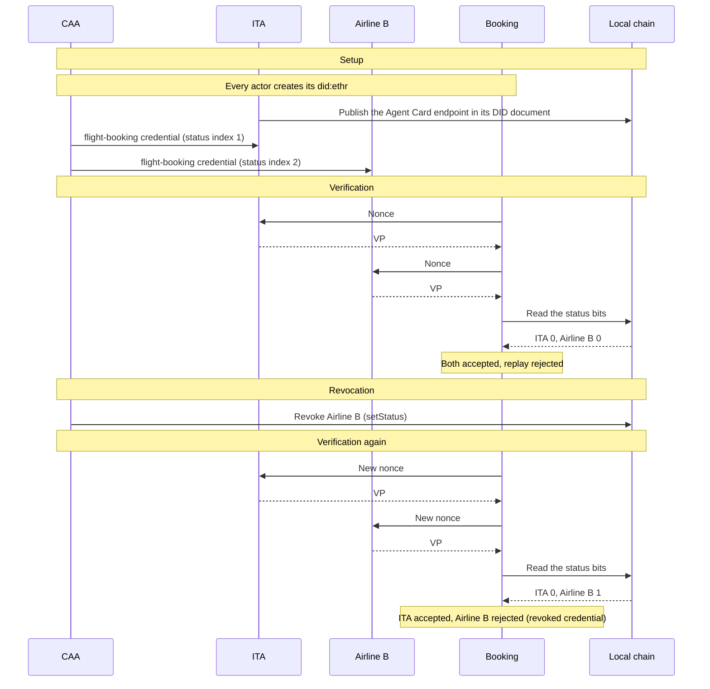

# Veramo credentials example

Issuing, presenting, verifying and revoking Verifiable Credentials with Veramo, using DIDs anchored on a local Ethereum chain. This is the first runnable piece of the business trip scenario: it implements setup and the credential checks of ITA Airways accepted, Airline B rejected, without A2A, agents or LLMs. All the reusable code comes from the `trust-aware-agentic-ai` library, whose source is in [`src/`](../../src/) at the repository root. This folder holds only the scenario, its tests and their outputs.

## Scenario

The Civil Aviation Authority (CAA) certifies airlines by issuing them a `flight-booking` skill credential, and keeps a revocation status list on-chain. When the Booking agent looks for an airline, it challenges each candidate with a fresh nonce, receives a Verifiable Presentation signed over that nonce, and checks the presentation, the credential inside it and the credential's status bit on-chain.

The scenario runs in four steps:

1. **Setup.** All actors get a `did:ethr` on a local chain. ITA publishes its Agent Card endpoint in its DID document. The CAA issues a credential to ITA and one to Airline B, each with its own index in the CAA's status list.
2. **Verification.** Booking challenges both airlines. Both are accepted, and a replayed presentation is rejected.
3. **Revocation.** The CAA revokes Airline B's credential with one transaction.
4. **Verification again.** Booking challenges both airlines with new nonces. ITA is accepted. Airline B is rejected with the reason `revoked credential`.



## Actors

| Actor | Role | DID |
|---|---|---|
| Civil Aviation Authority (CAA) | Issuer of `flight-booking` credentials, owner of a status list | `did:ethr:development:0x…` |
| ITA Airways agent | Holder of a valid `flight-booking` credential | `did:ethr:development:0x…`, with an `AgentCard` service endpoint |
| Airline B agent | Holder of a `flight-booking` credential that the CAA revokes | `did:ethr:development:0x…` |
| Booking agent | Verifier; trusts the CAA for `flight-booking` | `did:ethr:development:0x…` |

Every actor runs its own Veramo agent with its own SQLite database (`data/<actor>.sqlite`), key store and encrypted private key store. Nothing is shared: only DIDs, credentials, presentations and nonces travel between actors.

## How to run

Requirements: Node.js 26 (see [`.nvmrc`](../../.nvmrc) at the repository root; any Node ≥ 22.12 should work). Everything else is installed by npm, including Hardhat. The Solidity compiler is downloaded once, on the first compile.

```bash
nvm use          # optional, picks the version in .nvmrc
npm install      # at the repository root: the library and its dependencies
cd examples/veramo_credentials
npm install      # this example, which links the library from the repository root
npm run demo     # the scenario
npm test         # the tests
```

This example is a separate npm project. Its `package.json` depends on the library with `"trust-aware-agentic-ai": "file:../.."`, so npm links the repository root into `node_modules/trust-aware-agentic-ai` instead of copying it, and changes to the library are picked up without reinstalling. The library resolves its own dependencies from the root's `node_modules`, which is why the root is installed first.

Both commands compile the status list contract at the repository root if needed, start a local Hardhat chain, deploy the contracts, run, and stop the chain. No other terminal is needed. The demo uses port 8545 and the tests port 8546, so they can run at the same time.

Every check is printed as a readable line and appended as one JSON line to `events/<run>.jsonl`.

## How it works

### Code layout

The scenario and the tests import everything from `trust-aware-agentic-ai`. The library lives at the repository root: its source in [`src/`](../../src/), the status list contract in [`contracts/StatusList.sol`](../../contracts/StatusList.sol), the [`hardhat.config.ts`](../../hardhat.config.ts) that compiles it, and its unit tests in [`tests/`](../../tests/).

```
repository root: the trust-aware-agentic-ai library
  package.json               the library package, entry point src/index.ts
  hardhat.config.ts          compiles the contract and runs the local chain
  contracts/StatusList.sol   minimal on-chain status list (one bitstring per issuer)
  src/                       the trust layer, future trust layer of the A2A agents
    index.ts                 public entry point
    actor.ts                 one Veramo agent per actor (SQLite, KMS, did:ethr provider and resolver, JWT credentials)
    identity.ts              did:ethr creation, service endpoints, resolution
    credentials.ts           skill credential issuing, nonces, presentations
    verification.ts          presentation, credential and service endpoint checks returning { ok, reason, durationMs }
    status.ts                status list: credentialStatus entries, revocation, status checker
    chain.ts                 Hardhat node lifecycle, contract deployment, funding
    events.ts                JSONL event log and console summary
  tests/                     unit tests of the library

examples/veramo_credentials: this example
  package.json               depends on trust-aware-agentic-ai (file:../..)
  src/scenario.ts            the scenario: a thin script on top of the library
  tests/                     tests of the scenario, run with node:test and tsx
  data/, events/             actor databases and event logs, written at run time
```

### Setup

1. A Hardhat node starts on `127.0.0.1:8545` (chain id 31337). Hardhat account #0 deploys the ERC-1056 registry from the published `ethr-did-registry` package and the `StatusList` contract.
2. Each actor's Veramo agent is configured with the network `{ name: "development", chainId: 31337, rpcUrl, registry }`, so DIDs look like `did:ethr:development:0x02…`. Veramo uses the compressed secp256k1 public key as identifier. The controller address derived from it appears in the resolved document as `blockchainAccountId`. Creating a DID costs nothing: an ERC-1056 identity exists implicitly.
3. ITA adds a service endpoint of type `AgentCard` pointing to `http://localhost:9001/.well-known/agent-card.json`, where its Agent Card will live in the A2A examples. This is a `setAttribute` transaction on the registry, signed by ITA's key inside its KMS and paid by ITA's address, which the deployer funds first. Booking resolves ITA's DID and finds the service in the document.
4. The CAA issues a `SkillCredential` to each airline, as a JWT (`application/vc+jwt`), with `credentialSubject.skill = "flight-booking"` and a `credentialStatus` entry:

   ```json
   {
     "id": "eip155:31337:0x<contract>/0x<issuer address>/2",
     "type": "EthereumStatusListEntry",
     "statusPurpose": "revocation",
     "statusListIndex": "2",
     "statusListContract": "eip155:31337:0x<contract>"
   }
   ```

### Verification: Before and after revocation

For each airline, Booking generates a random nonce. The airline creates a presentation with its credential, signed over the nonce (`nonce` claim) and addressed to Booking (`aud` claim). Booking verifies it with the same nonce, and once more with a different nonce to simulate a replay, which fails with `challenge mismatch`.

[`StatusList.sol`](../../contracts/StatusList.sol) keeps one bitstring per issuer, keyed by `msg.sender` and stored as 256-bit words. `setStatus(index, value)` changes a bit of the caller's own list, and `getStatus(issuer, index)` reads any bit. Only the issuer can touch its list, because the storage is keyed by its address. The CAA revokes Airline B with one `setStatus(index, true)` transaction, signed by its controller key through Veramo's KMS.

For each credential, right after Veramo's signature check, Booking resolves the issuer's DID document and takes the controller address from it. It then reads bit `statusListIndex` of that issuer's list in the referenced contract. The address written in the credential is never trusted: the bit that counts belongs to the DID that signed the credential. Before the revocation both bits are 0 and both airlines are accepted. After it, Airline B's bit is 1 and Airline B is rejected.

### Verification: Steps

`verifyPresentation` in [`src/verification.ts`](../../src/verification.ts) returns `{ ok, reason, durationMs, details }`. The steps, and the reason returned when one fails:

| Step | Who checks | Reason on failure |
|---|---|---|
| Presentation signature, holder, `nonce`, `aud`, validity dates | Veramo | `invalid presentation signature`, `challenge mismatch`, `audience mismatch`, `invalid presentation` |
| At least one credential in the presentation | trust layer | `no credential in presentation` |
| Each credential's signature and validity dates | Veramo | `invalid credential signature`, `expired credential`, `credential does not match its proof`, `invalid credential` |
| Each credential's status bit, when it has `credentialStatus` | trust layer, on-chain | `revoked credential`, `status check unavailable` |
| A skill credential for the requested skill | trust layer | `skill mismatch` |
| Its subject is the presentation holder | trust layer | `subject mismatch` |
| Its issuer is in the verifier's trusted issuers | trust layer | `untrusted issuer` |

Veramo's presentation check does not verify the credentials inside a presentation, so each one is verified separately. Credentials are read from the signed JWT payload, not from the outer JSON, so a tampered JSON copy cannot change what is verified.

### Event log

Every check is one line of `events/<name>-<timestamp>-<runId>.jsonl`:

```json
{"ts":"…","runId":"cc9de859","phase":"after revocation","check":"valid presentation (Airline B)","verifier":"did:ethr:development:0x03…","holder":"did:ethr:development:0x03…","expected":"rejected","pass":true,"ok":false,"reason":"revoked credential","durationMs":85.76,"details":{"holder":"…","issuer":"…","statusListContract":"eip155:31337:0x…","statusListIndex":2,"issuerAddress":"0x…"}}
```

`phase` is `setup`, `before revocation` or `after revocation` (`test` for the tests). `expected` and `pass` record what the scenario expected and whether the outcome agreed, so false accepts and false rejects can be counted later. `durationMs` is the wall-clock time of the whole check, including DID resolution and chain reads.

## Tests

`npm test` runs `tests/credentials.test.ts` with Node's built-in test runner, on its own chain on port 8546. It covers:

- a valid presentation is accepted;
- a presentation with the wrong challenge is rejected;
- a credential is accepted before its revocation and rejected after it;
- a credential whose `credentialSubject` was modified in the signed payload is rejected;
- a credential modified to point at another, valid status bit is rejected;
- a credential whose JSON was modified after signing is rejected;
- a credential for another skill, from an untrusted issuer, or presented by someone other than its subject is rejected;
- a credential with a status entry is rejected when the verifier cannot check its status;
- an issuer cannot change another issuer's bits;
- a service endpoint added to a DID document appears in the resolved document.

The library has its own unit tests, module by module, in [`tests/`](../../tests/) at the repository root. They run with `npm test` there, on ports 8547 to 8550.